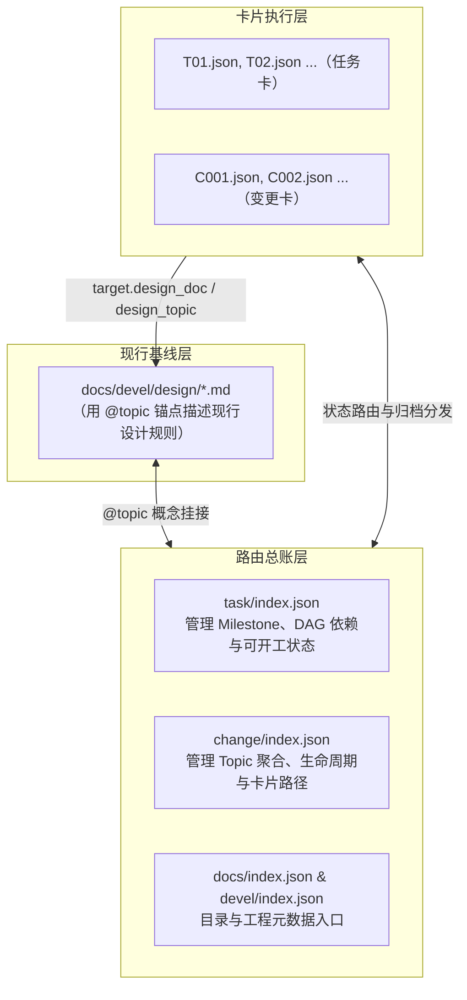

# ad-flow

面向 AI Agent 与开发者的文档驱动开发治理技能包：在目标项目中落地现行设计基线、双轨卡片（变更卡 / 任务卡）、JSON 路由索引、工作流规范以及纯标准库校验器。

当前治理规范版本：[**1.8.1**](https://github.com/4everSivan/ad-flow/releases/tag/v1.8.1)。变更记录见 [CHANGELOG](CHANGELOG.md)。

**使用方式很简单：首次在项目中调用一次完成初始化；日常直接用自然语言提需求；只有想同步新版规范时才再次调用。** 安装进项目的规则、模板和校验器都是独立文件，更新本技能包不会后台改动已有项目。

快速导航：[解决什么问题](#为什么需要-ad-flow) · [初始化流程（含漫画）](#初始化流程) · [日常开发流转（含漫画）](#双轨流转与架构) · [安装产物与目录](#安装产物与目录隔离) · [校验命令参考](#校验器命令参考) · [仓库与发版](#技能仓库与维护发版)

---

## 为什么需要 ad-flow

AI 编码助手在实际项目里最常见的问题，不是写不出代码，而是容易失忆和跳步：设计文档跟代码越跑越偏、待办列表写完不删越积越多、改完一个 Bug 顺手把别的规则改坏、或者测试没跑通就宣称“已完成”。

`ad-flow` 用一套结构化的项目文件加上一个确定性校验脚本 `scripts/adflow-verify`，把“先查基线、再建卡施工、用证据收口”变成项目里的硬约束：

1. **一份现行设计基线**：`docs/devel/design/` 只维护当前已批准的业务与技术规则，不搞文档小版本号，通过 `<!-- @topic: TopicName -->` 锚点保持全文互认。还没实现的能力在对应章节挂接现行 `T` 卡，实现进度以卡片状态和验收证据为准。
2. **双轨卡片与索引路由**：日常缺陷和微调走变更卡（`Cxxx`），阶段特性与结构改造走任务卡（`Txx`）。卡片通过 `target.design_doc` 和 `target.design_topic` 明确挂接设计文档；现行 `index.json` 只管活跃卡路径，发版时整批卡片移入 `docs/archive/<version>/` 并冻结到批次总账，设计文档零改动、不断链。
3. **待办缓冲用完即删**：零散缺陷、临时想法和远期技术债暂存在 `docs/devel/todo/now.md` 和 `future.md`。一旦建卡立项，对应待办行立即删除，避免待办列表堆积成过时文档。
4. **构建产物与运行事实留在 `local/`**：编译打包产物（`local/dist/`、`local/bin/`、`local/build/`）和运行时数据（`local/data/`、`local/logs/`）统一收拢在 `local/`，避免污染源码树。`docs/guide/` 写标准部署手册，`local/deploy_report.md` 记本机实际端口、DB 路径和进程 PID；涉及运行实例时对照两者核实，且 Agent 不得擅自删除 `local/`。
5. **显式记录开发分支**：卡片通过 `branch` 字段声明执行分支并汇总到总账。实际切分支、提交和合入仍由 Git 完成，字段本身不负责工作区隔离。

### 能力范围与明确边界

| 能力 | 实际行为 | 边界与不负责的事 |
|---|---|---|
| 一次初始化 | 安装 24 个治理文件（含 10 个目录 README 和 `coding.json`）及 2 个校验器文件 | 日常开发无需再调用本技能或访问技能源目录 |
| 版本感知升级 | 比对版本后刷新受管理的规范和模板 | 保留设计正文、已有卡片及 `gate`、待办、索引登记和项目自定义规则 |
| 存量资产迁移 | 取得授权后先做隔离备份，再结合旧文档与源码重构设计基线 | 备份目标已存在时停手；来源不明确时如实记录未决问题，不编造事实 |
| 双轨卡片与预检回调 | C 卡记录修复与前后规则差异，T 卡记录阶段目标与依赖；用 `precheck` 防重复施工，用 `callback` 做前后检查 | 命令文本本身不授权部署、合入、推送或清理 |
| 结构校验 | 检查设计挂接、证据字段、提交祖先关系、索引一致、依赖关系及归档区终态 | 不证明应用逻辑正确、人工确认原话真实或业务验收已通过 |
| 目标状态预检 (`--to`) | 在内存中预检拟转入状态，配合 `--record` 可仅回写指定卡的 `gate` | 不自动修改卡片或索引的 `status`；`--card` 不缩小全项目检查范围 |
| 节点回执 (`--receipt`) | 状态同步后复核并输出固定格式回执（标题、批次、验收表、门禁、同步、人工、改动） | 只读；事实行由校验器填充，执行者只补充「未覆盖」「需要你」 |
| 发版批次预检 (`--release`) | 核对目标版本下的活跃卡是否已全部处于 `closed` / `completed` | 只读；不证明发布范围完整，未填 `version` 的未收口卡需人工界定 |
| 旁路诊断 (`ADVISORY`) | 提示缺失主题、依赖环、未完成前置即开工、里程碑/路由漂移、未登记归档卡、占位符未渲染等问题 | 不改变退出码，也不自动迁移或改写旧卡 |

> 说明：技能内部在既有节点内采用“生成、检查、局部修复”闭环（最多 3 轮，同一阻断连续出现两次即停止并汇报），并将确定性检查（版本号比对、JSON 结构、Git 祖先、索引一致性）交给脚本，语义审查仍需结合代码与设计单独确认。这些机制不会增加额外的用户命令或审批阶段。

---

## 快速开始

### 1. 首次初始化

运行校验器需要 **Python 3.7+**（仅用标准库，无需安装额外依赖；仓库 CI 在 Python 3.7、3.9、3.12 上持续验证）。让你的 Agent 加载本技能后，在目标项目对话中发送：

```text
$ad-flow
```

技能同时识别 `$ad-flow`、`/ad-flow`、`ad-flow`、`adflow` 以及明确的初始化/升级表述，可在后面附带项目路径（默认当前目录）。注意 `init`、`new-card`、`archive` 并不是技能子命令。

* **存量项目授权**：如果目标项目已有源码或旧文档，Agent 会先列出迁移范围并请求确认（若用户已明确授权或附带 `--yes`，则复用该授权）。该授权仅覆盖初始化本身，**不授权**部署、合入、推送、清理或代签人工验收。
* **选择代码规范**：初始化时可指定 `python`、`go`、`javascript`、`typescript`、`java`、`shell`、`cpp`、`rust`（支持多选），也可以只装通用规则。例如：

```text
$ad-flow，代码规范选择 Python 和 Go，沿用项目已有格式化配置。
```

未显式指定时，Agent 会根据项目现有源码和清单文件给出建议；空项目或技术栈不明时只安装通用规则。结果写入 `docs/standards/coding.json`，其中 `common` 按设计、命名、注释、接口文档、错误处理和测试分组，`languages` 仅保留所选语言的规则及官方来源（参考 [Google Engineering Practices](https://google.github.io/eng-practices/review/reviewer/looking-for.html)、[Google Style Guides](https://google.github.io/styleguide/) 与 [Rust 官方风格指南](https://doc.rust-lang.org/style-guide/)，JavaScript 来源已标注停止更新）。规则只约束新增与修改的自有代码，项目已有 formatter/linter 优先，初始化不会擅自装工具或批量格式化旧代码。

> 语言约定：`coding.json` 的语言规则片段和 `workflow.yaml` 执行说明使用英文；其余 README、`AGENTS.md`、设计、指南、待办与卡片说明采用中文正文，JSON 键名、状态值、命令与人工验收原话保持原样。代码注释与 API 文档沿用项目现有约定，未约定时默认中文。

### 初始化流程

Agent 按 [workflow.yaml](workflow.yaml) 中的 8 步流水线执行初始化（该文件是执行规范，不是命令行工具）。下图以一个已有源码和旧文档的存量项目为例：


| 步骤 | 动作 | 产出或检查重点 |
|---|---|---|
| 1 | 资产勘察与版本路由 | 判断走首次初始化、版本升级、同版核对还是报冲突退出 |
| 2 | 确认存量迁移授权 | 复用本次已给授权，或先向用户说明迁移范围并等待确认 |
| 3 | 创建隔离快照 | 先确保根目录 `.gitignore` 有效忽略 `/_adflow_backup/`，再核对路径后备份，绝不覆盖已有快照 |
| 4 | 安装项目规则 | 写入 `AGENTS.md` 与版本标签，保留项目既有自定义规则 |
| 5 | 安装目录规范 | 生成 10 个目录级 `README.md` |
| 6 | 安装索引、规范、模板与工具 | 补齐索引 JSON、模板、`coding.json` 与 `scripts/adflow-verify`（共 24 + 2 个文件） |
| 7 | 重构现行设计基线 | 有源码或旧文档时依据真实来源生成设计文档并登记，存疑处显式保留为未决问题 |
| 8 | 校验与收口汇报 | 运行 `--mode init` 与普通复核，区分汇报“规范状态”与“项目门禁结果” |

> 关于备份与 `.gitignore`：创建备份前会检查项目根 `.gitignore` 是否已有生效的 `/_adflow_backup/`（不存在则创建，已存在则保留原内容并按需追加，且不重复添加）。若备份路径此前已被 Git 跟踪，流程会单独列出提示，不会擅自改动 Git 索引。

### 2. 初始化后的日常使用

初始化完成后，日常提需求**不需要再写 `$ad-flow`**，Agent 会直接读取项目内的 `AGENTS.md`、各目录 README、模板和校验器开展工作。比如直接说：

```text
修复登录失败时缺少错误提示的问题，按本项目规范完成变更与验证。
```

用户提出按 T 卡推进后，Agent 会先按任务目录 README 中的 `grill-me` 提示词与用户至少讨论一轮，将结论用于设计与任务拆解。

建卡前，Agent 在项目内运行 `scripts/adflow-verify --scaffold new-card --plan ...` 生成只读计划；若 `scaffold.executable` 为 `false`，先补齐 `missing` 字段再重跑。确认可执行且核对建议卡号和拟变更清单后，才创建卡片、登记总账与主题、移出对应待办行，随后补全卡片正文并重跑校验。具体操作规程见 [变更 SOP](references/02-change-sop.md) 与 [任务 SOP](references/03-task-sop.md)。

### 3. 按需升级

升级技能包本身后，若想把新版规范同步到某个已有项目，在该项目的对话中执行：

```text
$ad-flow --upgrade
```

| 目标项目当前状态 | 执行行为 |
|---|---|
| 无 ad-flow 标签且无版本记录 | 勘察资产后进入首次初始化 |
| 低于 1.8.1，或已有无版本号的旧标签 | 进入保留业务资产的升级流（U1–U6） |
| 等于 1.8.1 | 先只读核对安装完整性：完整则零修改退出，残缺则续做未完步骤；附带 `--upgrade` 或 `--force` 时才刷新受管规范 |
| 高于 1.8.1 | 拒绝降级（即使带 `--force`） |
| 版本来源冲突或格式无效 | 直接报错停止，不做写入 |

升级流（U1–U6）依次完成：确认备份忽略规则并新建带独立 `run_id` 的 `upgrade_snapshot/` → 同步 `AGENTS.md` 受管规则 → 刷新 10 个目录 README → 更新 `docs/standards/` 下的 C/T 模板与校验工具（原有 `coding.json` 逐字节保留）→ 更新治理版本号 → 只读校验并汇报（升级检查**不带 `--record`**）。

几条重要兼容规则：
* **只刷规范，不动业务**：现有设计文档、业务卡片、待办、索引登记、历史指南文件名以及自定义规则均保留原样，不批量改写旧卡，也不强行瘦身现行总账。
* **旧布局只读兼容**：未登记 `coding.json` 或沿用旧指南/模板路径的项目，同版本完整性检查直接放行；只有明确同步规范时才会把模板与规范收拢到 `docs/standards/`（遇到双份内容冲突先报告不覆盖）。
* **历史非终态归档卡 (`ARCHIVE_NON_TERMINAL`)**：自 v1.4.0 起，归档区出现非 `closed`/`completed` 的卡片会直接触发 Exit 4 阻断。存量老项目升级后如果暴露出此类历史卡，升级过程本身只报告不改写，需按目标项目归档 README 的「历史批次账实修复」流程由人工定口径处置（补收、回迁或废弃并记勘误）。

---

## 双轨流转与架构

下图以“修复登录失败提示”为例，展示一次需求从初始化、核对基线、只读计划建卡，到开发测试、人工确认与发版归档的完整过程：


### 三层解耦结构

`ad-flow` 将项目文档拆成“设计基线层 — 路由总账层 — 卡片执行层”三层，避免设计文档被流水账淹没：



* `target.design_doc` 必须指向真实设计正文，正文中需包含匹配的 `<!-- @topic: TopicName -->`；目录 `README.md` 不能代替设计文档。
* 卡片的 `scope` / 影响范围按领域能力描述，物理路径由总账管理，实现设计基线与卡片文件的解耦。

### 双轨日常流转

```text
[待办暂存]  缺陷 / 微调 / 突发  ──► docs/devel/todo/now.md
            远期特性 / 技术债    ──► docs/devel/todo/future.md
            （建卡后即从待办删除 · 卡号全局递增）

[通道 A：变更修复流 (C 卡)]
  now.md 登记 ─► --scaffold new-card --plan（executable=true）
    ─► 落盘 change/Cxxx.json、登记总账与主题、移出待办
    ─► 补齐 design.rule_diff、precheck 与 callback ─► 复核校验
    ─► 执行 precheck 确认问题存在 ─► callback.before 准备环境
    ─► 切分支修复 + 回归测试 ─► callback.after 质量门禁
    ─► 收集证据与人工确认原话 ─► 预检 verified ─► 同步状态 ─► 输出回执
    ─► 授权合入、回写基线与 CHANGELOG ─► 预检 closed ─► 同步状态 ─► 输出回执

[通道 B：阶段任务流 (T 卡)]
  用户提出按 T 卡推进 ─► grill-me 对抗性讨论
    ─► 撰写或修订设计基线 (@topic)
    ─► --scaffold new-card --plan（executable=true）
    ─► 落盘 task/Txx.json、登记总账与主题、移出待办
    ─► 补齐 depends_on、precheck、callback 与验收条件 ─► 复核校验
    ─► 按 DAG 拓扑顺序开工 ─► precheck ─► callback.before
    ─► 编码实现 + 单元测试 ─► callback.after
    ─► 满足 DoD ─► 输出回执请求人工确认 ─► 记录确认原话
    ─► 预检 completed ─► 同步状态 ─► 输出回执
    ─► 发版时整批移入 archive/<version>/ 并冻结批次总账
```

---

## 安装产物与目录隔离

### 目标项目产物布局（24 个治理文件 + 2 个校验器文件）

执行 `$ad-flow` 后，目标项目会获得以下结构（`local/` 由后续授权的构建或部署使用，初始化不会触碰里面已有的数据）：

```text
<目标项目根目录>/
├── AGENTS.md                         # [1/24] 项目协作规则，含 <!-- @ad-flow: initialized v1.8.1 --> 标签
├── CHANGELOG.md                      # [2/24] 版本日志，[Unreleased] 挂接变更与任务卡
├── .gitignore                        # 确保忽略 /_adflow_backup/（保留已有规则，不计入 24 个文件）
│
├── local/                            # 本地构建与运行隔离区（建议加入 .gitignore，Agent 严禁擅自删除）
│   ├── dist/                         # 打包输出目录（前端 bundle、wheel、jar 等）
│   ├── build/                        # 编译临时与中间产物
│   ├── data/                         # 本地数据库与持久化数据
│   ├── logs/                         # 本地运行与调试日志
│   └── deploy_report.md              # 本机部署实况（实际端口、DB 路径、PID、健康检查回执）
│
├── docs/
│   ├── README.md                     # [3/24] 文档中心总览与共同校验规则
│   ├── index.json                    # [4/24] 顶层目录路由与工程元数据（含 adflow_version）
│   │
│   ├── assets/
│   │   └── README.md                 # [5/24] 静态资源命名、体积与引用规范
│   │
│   ├── guide/
│   │   ├── README.md                 # [6/24] 操作指南索引与编写约定
│   │   ├── index.json                # [7/24] 指南机器索引
│   │   └── 01-本地部署指南.md        # [8/24] 标准环境搭建、启动命令与健康检查手册
│   │
│   ├── standards/                    # 规范与卡片模板统一入口（无独立 README 或索引）
│   │   ├── coding.json               # [11/24] 代码规范（通用规则 + 所选语言片段）
│   │   ├── change-template.json      # [12/24] 变更卡模板
│   │   └── task-template.json        # [13/24] 任务卡模板
│   │
│   ├── devel/
│   │   ├── README.md                 # [9/24] 研发内场总览与双轨流转说明
│   │   ├── index.json                # [10/24] 研发内场总账路由
│   │   ├── design/
│   │   │   └── README.md             # [14/24] 设计基线目录规范与四章大纲
│   │   ├── change/
│   │   │   ├── README.md             # [15/24] 变更核验规范与前后对比要求
│   │   │   └── index.json            # [16/24] 变更卡总账（Topic 映射与分支路由）
│   │   ├── task/
│   │   │   ├── README.md             # [17/24] 任务研发规范（DAG 依赖与 DoD）
│   │   │   └── index.json            # [18/24] 任务卡总账（Milestone 与拓扑依赖）
│   │   ├── todo/
│   │   │   ├── README.md             # [19/24] 待办零沉淀说明
│   │   │   ├── now.md                # [20/24] 当前缺陷与微调待办表
│   │   │   └── future.md             # [21/24] 远期特性与技术债待办表
│   │   └── env/
│   │       ├── README.md             # [22/24] 开发环境治理说明
│   │       └── 01-环境缓存与依赖清理指南.md  # [23/24] 磁盘盘点、分级清理与重建 SOP
│   │
│   └── archive/
│       └── README.md                 # [24/24] 历史归档区规范与批次账实修复流程
│
├── scripts/                          # 校验器（不计入 24 个治理文件）
│   ├── adflow_verify.py              # 纯标准库校验引擎
│   └── adflow-verify                 # Shell 封装入口
│
└── _adflow_backup/                   # 存量初始化或升级时按需生成，被 .gitignore 忽略且快照只读
    ├── README.md                     # 备份声明
    ├── original_docs/                # 原文档备份（根目录文档与规则在 root_markdowns/）
    └── upgrade_snapshot/             # 每次升级按独立 run_id 建子目录
```

### `local/` 构建与运行隔离约定

1. **打包产物收拢到 `local/`**：所有编译输出和分发包（前端 `dist`、后端二进制、Python wheel/sdist、Java jar/war、导出镜像等）必须输出到 `local/dist/` 或 `local/bin/`，临时构建产物放到 `local/build/`。如果构建工具默认输出在项目根目录，通过构建参数（如 `--outDir local/dist`、`-o local/bin/app`）或脚本重定向，不让大体积产物和缓存散落在源码树里。
2. **区分“施工手册”和“运行实况”**：`docs/guide/01-本地部署指南.md` 写标准技术栈、环境变量、启动命令和健康检查端点；真正部署跑起来之后，在 `local/deploy_report.md` 记录本次实际端口、DB 路径、进程 PID、日志路径和健康检查结果。
3. **操作运行实例前先核对事实**：遇到测试、联调或重启已有实例时，优先读 `local/deploy_report.md` 并对照本机进程、监听端口和实际配置。报告缺失、过期或与现场矛盾时先结合部署指南排查，运行参数不明就暂停变更；授权部署或改配置后记得更新报告。（纯单元测试不依赖部署报告。）
4. **运行数据隔离与清理权限**：运行时生成的数据库（如 SQLite / DuckDB）、缓存和日志统一放进 `local/data/`、`local/logs/`。**AI Agent 不得擅自删除或重置 `local/` 目录**，本地调试数据、实测报告与打包产物的清理统一由人类在宿主机终端手工处理。

---

## 校验器命令参考

以下命令均在**已初始化的目标项目根目录**执行（也可将目标路径作为第一个位置参数传入，或直接用 `python3 scripts/adflow_verify.py`）。日常开发时由 Agent 根据需要自动执行并向用户汇报结果，人类不需要记参数。

### 常用命令

```bash
# 1. 初始化骨架检查：检查 23 个原有基础文件、已登记/存在的 coding.json、2 个工具及版本一致性
scripts/adflow-verify --mode init --json

# 2. 常规流程复核：按所有活跃卡当前状态检查前提条件，并扫描归档区是否混入非终态卡
scripts/adflow-verify --json

# 3. 诊断码目录：查看所有检查码、默认级别、释义与修复提示（静态目录，不依赖目标项目）
scripts/adflow-verify --list-checks

# 4. 建卡前置只读计划：落盘前获取建议卡号、设计解析结果与拟变更清单
scripts/adflow-verify --scaffold new-card --plan --track change --design-topic MarketService \
  --title "修复夜盘数据污染" --card-version v0.1.0 --branch fix/C027-night --json

# 5. 路由查询：查看下一建议卡号，或按 @topic 追溯现行与历史卡片
scripts/adflow-verify --next-id change
scripts/adflow-verify --topic MarketService
scripts/adflow-verify --topic MarketService --scope active
scripts/adflow-verify --topic MarketService --scope history

# 6. 目标状态预检与 gate 回写（假设目标卡为 C001 / T01）
scripts/adflow-verify --card C001 --to verified --json             # 仅内存预检，不写文件
scripts/adflow-verify --card C001 --to verified --record           # C 卡记录 user_quote/signoff 后预检 verified
scripts/adflow-verify --card C001 --to closed --record             # C 卡回填 sync.commit、基线与 CHANGELOG 后预检 closed
scripts/adflow-verify --card T01 --to completed --record           # T 卡满足 DoD、确认原话、依赖与 commit 后预检 completed

# 7. 节点回执复核：状态同步后运行，输出固定格式的 Markdown 回执
scripts/adflow-verify --card C001 --receipt

# 8. 发版批次预检：移卡归档、定稿 CHANGELOG 或打 Tag 前核对本批次全部卡片是否已终态
scripts/adflow-verify --release v0.1.0 --json
```

### 参数与退出码

| 参数 | 用途 | 写入行为 |
|---|---|---|
| `--json` | 输出工具版本、摘要统计（`summary.codes`）和问题清单（含 `hint`） | 无 |
| `--mode init` | 初始化骨架与工具版本检查 | 无；不可与 `--card`、`--to`、`--record` 混用 |
| `--card ID --to STATE` | 内存预检拟转入状态（C 卡支持 `verified`/`closed`，T 卡支持 `completed`）；`--to` 必须带 `--card` | 默认无 |
| `--card ID --record` | 运行全项目完整检查，并把结果回写到指定卡的 `gate` | 仅写该卡的 `gate` |
| `--record` | 兼容旧用法，批量回写所有活跃卡的 `gate` | 回写全部活跃卡；升级流程禁用 |
| `--card ID --receipt` | 状态同步后复核并输出该卡固定格式回执（`--json` 时置于 `receipt` 字段） | 无；不可与 `--to`、`--record`、`--warn-only`、`--mode init` 混用 |
| `--release VERSION` | 发版归档前预检（`v0.1.0` 与 `0.1.0` 视为同批次） | 无；不可与 `--card`、`--to`、`--record`、`--mode init` 混用 |
| `--next-id change\|task` | 综合现行总账、批次总账、归档目录及本机其他工作树/本地与远端跟踪分支给出下一卡号 | 无；看不到他人未推送分支，非原子占号 |
| `--topic NAME` | 列出该主题在现行总账与各归档批次中的卡片、状态、批次与路径 | 无；独占查询，不可搭其他模式参数或 `--warn-only` |
| `--topic NAME --scope active` | 只读两份现行总账与活跃卡实体（按 `file` 所属轨道排除旧归档项），不触碰 `docs/archive/` | 无；无结果返回空列表，总账缺失或失效报 Exit 4 |
| `--topic NAME --scope history` | 只读批次总账与旧布局归档登记，不读归档卡正文；同号同路径去重，同号异路径报冲突 | 无；独占只读查询 |
| `--list-checks` | 输出全部诊断码、默认级别、释义与修复提示 | 无；独占查询，不依赖目标项目 |
| `--scaffold new-card --plan` | 建卡前置只读计划（A6）：输出建议卡号及依据、模板、设计匹配与拟变更 | 无；不可与 `--record` 等混用 |
| `--warn-only` | 将 ERROR 降为 WARN 供观察；有违规时仍返回 6 | 无；不可与 `--record` 混用 |

| 退出码 / 级别 | 含义 | 后续动作 |
|---|---|---|
| `0` | 通过已覆盖的结构门禁 | 仍需另行核对业务证据、授权与人工确认，并单独报告 `ADVISORY` |
| `2` | 参数组合或取值非法 | 按帮助信息修正参数 |
| `4` | 存在确定性治理违规 | 阻断收口，根据诊断码和 `hint` 修复根因后重验 |
| `6` | 存在软告警或 `--warn-only` 观察发现 | 列出事实供人工判断；正式收口必须取得 Exit 0 |
| `ADVISORY` | 旁路提示（如缺失主题、依赖环、前置未完即开工、里程碑/路由漂移、终态验收不全为 true、未登记归档卡、总账重名或撞号、重复初始化标签、未渲染占位符等） | 不影响退出码，不作为硬门槛；完整释义见 `--list-checks` |

### 关键机制说明

* **建卡前置只读计划 (`--scaffold new-card --plan`)**：
  每次建 C/T 卡前都由 Agent 先运行计划，传入 `--track`（默认 `change`）、`--design-topic`、`--title`、`--card-version`、`--branch`，以及适用的 `--design-doc`、`--todo`（C 匹配 `now.md`，T 匹配 `future.md`）和 `--milestone`（任务卡）。设计挂接会自动排除 `README.md`，只匹配 `docs/devel/design/` 中包含对应 `@topic` 的正文。Agent 根据 `scaffold.executable` 判断能否落盘，缺项按 `missing` 补齐后重跑，落盘后再跑一次普通复核。（本仓库自身的建卡与归档执行规则见 [AGENTS.md](AGENTS.md#本仓库建卡与归档流程)。）

* **回写作用域与状态恢复 (`--card` / `--record`)**：
  `--card ID` 只把 `gate` 回写和 `--to` 预检限定在该卡上，**全项目所有活跃卡与全局规则仍照常参与检查**，因此其他卡或全局违规同样会影响当前退出码。`--record` 会按当前真实前提重算目标卡状态，不会把该卡历史遗留的失败 `gate` 当作新违规——问题修好后重跑即可恢复。总账或归档目录中的归档卡只读解析身份和终态，不按现行规则重验或回写。

* **节点回执 (`--receipt`) 与 `SIGNOFF_STALE`**：
  用于请求人工确认以及 `verified`、`closed`、`completed`、`rejected` 等节点。执行完状态同步后运行 `--card ID --receipt`，固定事实行直接来自卡片与本次复核，执行者原样转交，仅填写「未覆盖」和「需要你」两行。标题中的 `from → to` 取自 `--record` 时写入的 `gate.from_status` / `gate.target_status`；C 卡 `--record` 还会记录 `gate.signed_quote` 和 `gate.signed_rejection_count`，若卡片被驳回后仍沿用旧确认原话，校验器会报 `SIGNOFF_STALE`。回执格式规范见目标项目 `AGENTS.md` 二.3。

* **修复提示 (`hint`) 的使用原则**：
  普通复核的文本模式会在每条问题下打印 `↳ 修复`，`--json` 模式中对应 `findings[].hint`，`summary.codes` 则按诊断码统计本次各级别数量。当提示涉及人工确认原话、历史归档处置、真实 Git 提交或已有资产迁移时，需按指向的 SOP 取证或请示人类，不能把提示当成擅自改写证据的授权。

* **发版归档与账实校验 (`--release` / `ARCHIVE_NON_TERMINAL` / `LEDGER_ARCHIVED_ENTRIES`)**：
  * 归档区只允许存放 `closed` 或 `completed` 卡片；无论是通过总账路由还是直接扫描 `docs/archive/` 目录，发现非终态卡都会报 `ARCHIVE_NON_TERMINAL`（Exit 4）。
  * 打 Tag 或移卡归档前，需先跑 `--release <version>` 取得 Exit 0（普通复核 Exit 0 不证明批次内全部终态）。本批次仍有活跃卡未终态会报 `RELEASE_NOT_TERMINAL`（Exit 4），存在未填 `version` 的未收口卡则报 `RELEASE_SCOPE_UNKNOWN`（Exit 6）。
  * 归档时将本批次卡移入 `docs/archive/<version>/`、登记写入该目录的批次总账 `index.json`（`adflow-archive-batch-v1`）并从现行总账移出，定稿 `CHANGELOG.md` 后复核一次 Exit 0，提交后再在该提交上打 Tag。
  * 旧项目若仍在现行总账里保留历史归档登记仍可继续使用，校验器只报聚合 `ADVISORY`（`LEDGER_ARCHIVED_ENTRIES`）；需要瘦身时按目标项目归档 README「现行总账瘦身」操作，以瘦身前后普通复核、`--next-id` 与 `--topic` 输出一致作为等价证据。

* **多分支并行合入前检查**：
  当主干把卡片归档进批次总账后，另一分支新建同号活跃卡并不会触发 Git 文件冲突（因为路径不同）。合入主干前建议在预合并状态上跑一次校验：

  ```bash
  git merge --no-commit --no-ff <分支>
  scripts/adflow-verify
  ```

  确认 Exit 0 且没有 `LEDGER_DUPLICATE_KEY`（解决合并冲突时保留了同卡号两条登记，JSON 解析只认最后一条）或 `ARCHIVE_ID_COLLISION`（未登记归档卡撞号）后再提交。（这两项目前为 `ADVISORY`，后续版本计划升为阻断。）

* **工具本身的局限与覆盖边界**：
  * 校验器不替代应用测试、源码与设计的一致性审查或人工验收，也不会自动审计所有历史归档卡。
  * `sync.commit` 仅验证是否属于当前 `HEAD` 的祖先提交，不检查是否已经合入主干；证据字段非空也不代表原话真实或业务结论成立（详见 [审计清单](references/05-audit-checklist.md)）。
  * `coding.json` 检查仅核对已登记文件路径存在且 JSON 可解析，不校验源码风格。
  * `--mode init` 会核对 `scripts/adflow_verify.py` 版本与 `docs/index.json.adflow_version` 是否一致（不一致报 `TOOL_VERSION_DRIFT`，Exit 4），并提示未渲染的 `MyProject`、`YYYY-MM-DD` 占位符（`PLACEHOLDER_UNRENDERED`）。

---

## 技能仓库与维护发版

### 仓库目录结构

```text
skills/ad-flow/
├── SKILL.md                          # 面向 Agent 的技能入口与执行边界
├── workflow.yaml                     # 8 步初始化状态机与 24+2 文件安装/升级映射
├── README.md                         # 本说明文档
├── AGENTS.md                         # 维护本技能仓库自身的约定（不安装到目标项目）
├── .github/workflows/ci.yml          # GitHub Actions：Linux/macOS × Python 3.9/3.12 与 Ubuntu 22.04 × 3.7 跑 tools/check.sh
│
├── scripts/                          # 随技能安装到目标项目的校验器
│   ├── adflow_verify.py
│   └── adflow-verify
│
├── tools/                            # 技能包维护者测试与发版工具（不安装到目标项目）
│   ├── check.sh                      # 统一检查入口：单测 + 版本一致性 + 包映射 + shell 语法
│   ├── check_package.py              # 校验 workflow.yaml 机器块与 24+2 映射
│   ├── test_adflow_verify.py         # CLI 门禁与各种场景回归测试
│   ├── test_checks_catalog.py        # 诊断码目录、提示与计数统计测试
│   ├── test_check_package.py         # 安装映射负例与端到端 --mode init 测试
│   ├── test_scaffold.py              # 建卡只读计划测试
│   ├── test_agent_surface.py         # Agent 命令面与模板约束测试
│   └── bump_version.py               # 发版同步工具：统一核对/更新版本号并切分 CHANGELOG
│
├── templates/                        # 注入目标项目的脚手架模板
│   ├── AGENTS.md.tpl
│   ├── coding-standards/             # 8 种语言 JSON 规则片段
│   └── docs/                         # README、index、design、change、task、todo、guide、env、archive、standards 模板
│
├── references/                       # 供 Agent 按需查阅的操作手册
│   ├── 01-mental-model.md
│   ├── 02-change-sop.md
│   ├── 03-task-sop.md
│   ├── 04-index-routing.md
│   ├── 05-audit-checklist.md
│   ├── 06-exception-and-hotfix.md
│   └── 07-release-archive-sop.md
│
└── examples/                         # 卡片、总账与设计文档写法样例（不写入目标项目索引）
    ├── sample-change-card.json
    ├── sample-task-card.json
    ├── sample-change-index.json
    ├── sample-task-index.json
    ├── sample-archive-index.json
    └── sample-design-doc.md
```

### 运行仓库回归检查

维护本技能包时，在仓库根目录运行（与 `.github/workflows/ci.yml` 在 Linux/macOS 的 Python 3.9、3.12 以及 Ubuntu 22.04 的 Python 3.7 上跑的是同一条命令）：

```bash
./tools/check.sh
```

它依次执行 `tools/` 下的单元测试、`bump_version.py --check`、`check_package.py` 以及 `sh -n scripts/adflow-verify`。测试全部跑在临时工程夹具中，覆盖旧版兼容、只读预检、指定卡回写、发版预检、诊断目录、样例与模板字段同步、版本一致性与端到端安装检查。受控技能调用和真实项目上的升级验证仍需单独记录，源仓库 CI 也不代表目标项目的业务验收。

### 技能维护与发版

治理版本号分散在校验器、`workflow.yaml`、`SKILL.md`、`README.md`、`AGENTS.md` 模板、索引和卡片模板等 23 处，以 `scripts/adflow_verify.py` 的 `VERSION` 为准，统一由 `tools/bump_version.py` 维护（不要手工逐处修改）：

1. 确认所有改动已记入 `CHANGELOG.md` 的 `[Unreleased]`，且 `./tools/check.sh` 全部通过。
2. 运行 `python3 tools/bump_version.py <X.Y.Z>`：脚本会同步全部版本号，把 `[Unreleased]` 切为 `[X.Y.Z] - <今天>` 并更新比较链接（若 `[Unreleased]` 为空、版本未递增或现状不一致，会直接拒绝且不改文件）。
3. 检查 `git diff` 后重跑 `./tools/check.sh`，提交 `chore(release): publish vX.Y.Z`。
4. 在**该发布提交**上打 Tag `vX.Y.Z`（GitHub Release 正文取该版本条目），确认后再推送。
5. 打 Tag 之后的修复重新记入新的 `[Unreleased]` 随下一版发布，不移动已发布的 Tag，也不在提交标题里沿用旧版本号。
