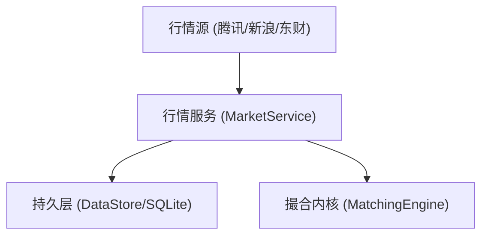

# 行情服务设计方案

> **created**: 2026-09-11 ｜ **last-change**: 2026-09-20 ｜ **status**: baseline

## 1. 简介

行情服务负责多数据源的实时行情采集、快照清洗与落库。在后端全局分层架构中位于数据采集与接入层，为下游撮合引擎与前端控制台提供稳定的行情数据基座。本文为已批准的现行基线；尚未交付的能力由对应 T 卡记录。

## 2. 索引

- 文档 ID：DESIGN-MARKET
- 所属总体：[系统总体设计](00-系统总体设计.md)
- 对应主题：MarketService
- 执行记录：[变更总账 (MarketService)](../change/index.json#MarketService)

## 3. 规范

| 接口端点 / 数据表 | 职责说明 | 输入输出契约 |
|---|---|---|
| `GET /api/market/kline` | 查询标的多周期历史 K 线数据 | 入参 `code`, `period`；回执包含日K数据数组 |
| `GET /api/market/minute` | 查询标的当日盘中分时数据 | 入参 `code`；回执包含 242 根分钟级分时数据 |

非交易时段的轮询不得触发日切；所有数据源均失败时回退到历史锚点并记录降级原因，不返回伪造行情。

## 4. 设计详情

### 4.1 架构与行为

### 4.2 核心业务规则

<!-- @topic: MarketService -->

1. **日K启动引导与全量拉取**：
   * 实例启动时，对自选股与关注标的集拉取全量历史日K；
   * 数据契约强制采用 7 元组格式：`(code, date, open, close, high, low, volume)`，由适配器层完成入库前清洗，保证标的代码不丢失；
2. **多源降级链**：
   * 行情轮询按优先级自动降级：`腾讯接口(HTTP/HTTPS) -> 新浪备用源 -> 东方财富 -> 历史锚点`；
3. **盘中分时与增量落库**：
   * 盘中按分钟桶聚合增量落盘，停机时触发终态刷盘，日切时统一收口；
   * 严格校验交易日历，未来日期守卫拦截非交易时段的伪日切轮询。

### 4.3 验证与实现情况

日K 7 元组契约与降级链已随 v0.1.0 交付，回归用例覆盖元组长度与降级顺序；夜盘时段数据隔离尚在变更中，以变更总账中的卡片状态为准。

### 4.4 规则演进

历史卡片的物理位置由变更总账维护，本表只记编号，不直接链接会随归档移动的卡片文件。

| 编号 | 类型 | 简介 | 规则演进 |
|---|---|---|---|
| C001 | BugFix | 修复日K引导缺code | 启动引导历史日K由 6 元组改为 7 元组契约 |
| C008 | Refactor | 扩充降级链 | 增加新浪/东财多级源兜底 |
| C010 | BugFix | 修复腾讯源时间戳致单桶失真 | 时间戳统一归一为 HH:MM:SS，异常不落桶 |

### 4.5 参考资料

- 行情适配器源码与回归用例（以仓库当前提交为准）。
- 各行情源公开接口说明；字段口径以实际返回为准。
